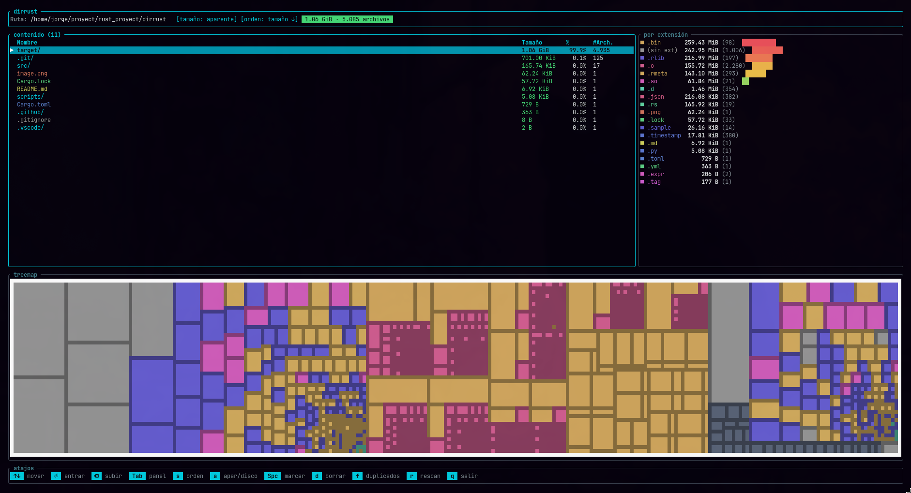
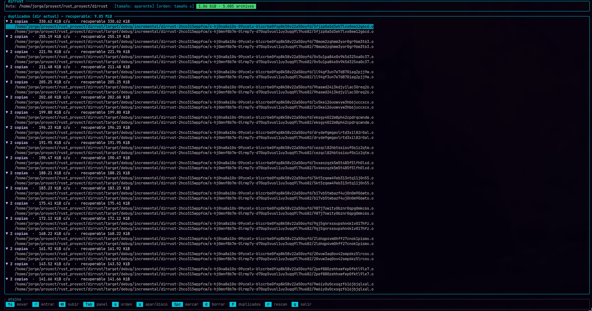

# dirrust

Analizador de uso de disco para terminal (TUI) al estilo **WinDirStat**, escrito
en Rust. Rápido, 100 % local y potente: escaneo paralelo no bloqueante, **treemap**
de colores, tabla de ranking, desglose por extensión, detección de duplicados y
borrado seguro (papelera o permanente).

> ⚠️ **Aviso**: `dirrust` puede borrar archivos. El **borrado permanente es
> irreversible**. Lee la sección de [Borrado seguro](#borrado-seguro) antes de
> usarlo y prueba primero en un directorio de usar y tirar.

---

## Capturas

### Vista principal

Tabla de ranking, desglose por extensión y *treemap* de colores del directorio
analizado.



### Vista de duplicados

Grupos de archivos con contenido idéntico detectados por hash, listos para
borrado seguro (tecla `f`).



---

## Características

- **Escaneo paralelo** con [`jwalk`] en un hilo de fondo: la UI nunca se bloquea.
- **Refresco en vivo**: la tabla y el treemap se van construyendo durante el escaneo.
- **Treemap squarified** (Bruls et al.) renderizado en truecolor con técnica de
  **medio bloque** (`▀`) para duplicar la resolución vertical. Color consistente
  por extensión. Sombreado *cushion* opcional (look 3D).
- **Tabla de ranking** ordenable (tamaño / nombre / nº de archivos).
- **Desglose por extensión** del subárbol actual, con la misma paleta del treemap.
- **Detección de duplicados** por contenido (hash xxh3 en paralelo, en 3 fases:
  tamaño → hash parcial → hash completo).
- **Borrado seguro**: papelera (XDG Trash) o permanente, con guardas de rutas
  protegidas y doble confirmación para directorios no vacíos.
- **Teclado (estilo vim) y mouse** completos: clic, doble clic, scroll y hover.
- Tamaño **aparente** o **en disco** (`st_blocks × 512`), conmutable en caliente.

---

## Compilación

Requiere un toolchain de Rust reciente (edición 2021).

```bash
# Compilación optimizada (recomendada para árboles grandes)
cargo build --release

# El binario queda en:
./target/release/dirrust
```

Para ejecutar directamente:

```bash
cargo run --release -- [RUTA] [OPCIONES]
```

---

## Uso

```
dirrust [RUTA] [OPCIONES]

Argumentos:
  [RUTA]                 Directorio a analizar (por defecto: el actual)

Opciones:
  --apparent             Tamaño aparente (por defecto)
  --disk                 Tamaño en disco (bloques ocupados)
  --follow-symlinks      Seguir enlaces simbólicos (por defecto: no)
  --one-file-system      No cruzar puntos de montaje (por defecto: sí)
  --cross-file-systems   Permitir cruzar a otros sistemas de archivos
  --no-mouse             Desactivar la captura de mouse
  --cushion              Activar el sombreado 3D "cushion" del treemap
  --threads <N>          Nº de hilos de escaneo (0 = automático)
  -h, --help             Ayuda
  -V, --version          Versión
```

Ejemplos:

```bash
dirrust ~                      # analiza tu home (tamaño aparente)
dirrust --disk /var/log        # tamaño en disco
dirrust --cushion --threads 8 /datos
```

---

## Atajos

### Vista principal

| Tecla | Acción |
|---|---|
| `↑`/`↓` o `j`/`k` | Mover la selección |
| `g` / `G` | Ir al principio / al final |
| `Re Pág` / `Av Pág` | Saltar 10 filas |
| `Enter`, `→`, `l` | Entrar al directorio seleccionado |
| `←`, `h`, `Retroceso`, `Esc` | Subir un nivel |
| `Tab` | Cambiar el foco entre tabla y treemap |
| `s` | Ciclar el criterio de orden |
| `a` | Alternar tamaño aparente / en disco (re-escanea) |
| `Espacio` | Marcar / desmarcar el elemento (lista de marcados) |
| `d` | Borrar el elemento seleccionado (abre confirmación) |
| `D` | Borrar TODOS los elementos marcados (lote) |
| `f` | Ver la lista de duplicados |
| `t` | Alternar entre la vista clásica y el modo mapa |
| `r` | Re-escanear |
| `q`, `Ctrl-C` | Salir |

### Mouse

- **Clic** en una fila o en un rectángulo del treemap: selecciona.
- **Doble clic**: entra al directorio.
- **Rueda**: desplaza la selección.
- **Hover** sobre el treemap: resalta el rectángulo y muestra su info en el título.

### Vista de duplicados (`f`)

| Tecla | Acción |
|---|---|
| `↑`/`↓` o `j`/`k` | Mover entre archivos duplicados |
| `d` | Borrar el archivo seleccionado (flujo de borrado seguro) |
| `f` / `Esc` | Volver a la vista principal |

### Modo mapa (`t`)

Treemap a pantalla completa con el nombre y el tamaño escritos en cada tile,
coloreado por **categoría** (código, toolchains, git, multimedia, documentos,
agentes…) en vez de por extensión. Lo **recuperable** (cachés, papelera y
salidas de build como `target/` o `node_modules/`) aparece **rayado** `╱`. El
panel lateral muestra la selección, una lista *«vale la pena mirar»* con lo
recuperable del directorio actual (de mayor a menor), los marcados y el
espacio libre del disco.

| Tecla / gesto | Acción |
|---|---|
| `h` `j` `k` `l` / flechas | Moverse al tile vecino en esa dirección |
| `Tab` / `Shift-Tab` | Siguiente / anterior por tamaño |
| `Enter` / doble clic | Entrar al directorio |
| `Retroceso`, `Esc` / clic derecho | Subir un nivel |
| `Espacio`, `d`, `D` | Marcar, borrar, borrar marcados (igual que en la vista clásica) |
| `t` | Volver a la vista clásica |

---

## Distribución de la pantalla

```
┌ dirrust ───────────────────────────────────────────────┐
│ Ruta: /home/...   [tamaño: aparente] [orden: tamaño ↓]  │  cabecera / estado
├──────────────────────────────────┬─────────────────────┤
│ TABLA (ranking)                  │ POR EXTENSIÓN        │
│  nombre | tamaño | % | #arch.     │  ■ .mp4  12.3 GB ███ │
├──────────────────────────────────┴─────────────────────┤
│ TREEMAP (rectángulos por tamaño, color por extensión)   │
├─────────────────────────────────────────────────────────┤
│ atajos…                                                  │
└─────────────────────────────────────────────────────────┘
```

---

## Borrado seguro

`dirrust` nunca borra nada sin una confirmación explícita en pantalla.

- La tecla `d` abre un **modal** con la ruta, el tamaño y, si es un directorio,
  cuántos archivos contiene. Opciones:
  - `P` → **Papelera** (XDG Trash, **reversible**).
  - `X` → **Permanente** (`remove_file` / `remove_dir_all`, **irreversible**).
    Para un **directorio no vacío** exige pulsar `X` una **segunda vez**.
  - `Esc` → Cancelar.
- **Rutas protegidas**: `dirrust` rechaza borrar rutas críticas (`/`, `/home`,
  tu `$HOME`, `/etc`, directorios de primer nivel, puntos de montaje, …). El modal
  lo indica y bloquea la acción.
- Tras borrar, el árbol y los agregados se actualizan **en memoria** (sin
  re-escanear). Si el borrado falla, se muestra el error sin cerrar la aplicación.

---

## Pruebas

```bash
cargo test          # tests de escaneo, navegación, treemap, borrado, duplicados…
cargo clippy        # sin warnings
cargo fmt --check   # formato
```

Para validar las cifras con datos conocidos, genera un árbol de prueba:

```bash
python3 scripts/gen_fixture.py /tmp/dirrust_fixture
dirrust /tmp/dirrust_fixture
```

El script imprime los tamaños esperados por carpeta, el desglose por extensión y
los grupos de duplicados, para comparar con lo que muestra `dirrust`.

---

## Detalles de implementación

- **Árbol-arena compacto**: los nodos (72 bytes) viven en un `Vec` y se
  referencian por índice `usize`. Los nombres van en un único buffer de texto
  compartido y las extensiones se internan como un id, sin reservas de memoria
  por nodo.
- **Escaneo paralelo de verdad**: el `stat` de cada archivo se hace en los hilos
  de [`jwalk`] (`process_read_dir`). El padre de cada entrada se deduce con una
  pila por profundidad (jwalk entrega en preorden), sin construir rutas.
- **Agregación incremental**: cada archivo suma su tamaño a sus ancestros al
  insertarse, así que el árbol siempre está agregado y los snapshots en vivo
  son copias planas. Se espacian a 10× lo que cuesta cada copia, para que nunca
  pesen más de ~10 % del escaneo. Un home de 2,1 M de entradas se escanea en
  ~1,2 s.
- **Concurrencia** vía `crossbeam-channel` entre el hilo de escaneo / duplicados y
  el hilo de UI.
- Los puntos sensibles del código están marcados con `// REVISAR:` (borrado,
  hit-testing, squarified, medio bloque, concurrencia, guardas de seguridad).

[`jwalk`]: https://crates.io/crates/jwalk
